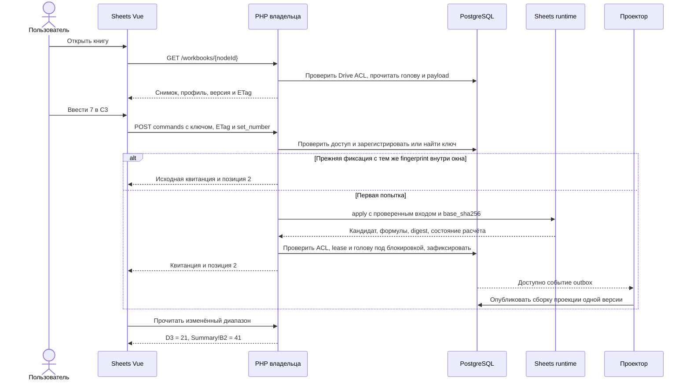

# Как проходит одна правка книги

Пример из [workbook.json](../examples/workbook.json). В Vue пользователь меняет цену груш в `Detail!C3` с 5 на 7. Версия книги 1, итог до изменения 35. Используется одиночный профиль со строгой проверкой версии. Узел уже создан через Documents.

Полные префиксы маршрутов, форматы сообщений, способы выдачи артефакта и ограничения размеров определены в [контракте Sheets](sheets.md); сообщения PHP ↔ Node, коды ошибок и digest — в [wire-контракте](runtime-wire-v1.md). Частные процессы, сети и очереди указаны в [Docker-карте](processes.md).

**Образец.** Весь путь этой страницы пройден в upstream-образце `workbook-operation`: точка вызова из Vue — `src/vue-client.ts:submitWorkbookCommand`; вычисление с барьером — `src/operation.ts:runOperation`; перепроверка головы под блокировкой и публикация — `php/Owner.php` `WorkbookOwner::commit` (замыкание `state->locked`), проверка digest — `WorkbookOwner::verifyCandidate`. Сценарии A0–A8 (35 → 41, вставка, повтор по ключу, устаревшая C3, холодное открытие, кэш 999, потеря ответа) покрыты контрактным гейтом `scripts/ci/workbook-contract.sh`.

| Шаг | Что выполнить | Что сохраняется или проверяется |
| --- | --- | --- |
| Открытие | PHP разрешает `node_id` в `v_documents.id`, проверяет ACL, `type`, `schema_version` и `write_mode`. Загрузить `v_document_payloads.content` либо удерживаемый Media-объект по manifest | Браузер получает только разрешённую версию. Ни модель, ни Node не получают DSN |
| Вычисление | В процессе `sheets-runtime` выполнить `set_number`. В ячейке D3 хранится формула, в Summary B2 межлистовая сумма. Дождаться барьера вычисления по полученному снимку | Подтверждённый числовой результат 21 и 41. Ожидание/ошибка расчёта имеет отдельное состояние. PostgreSQL-транзакция не держится во время обращения к Node |
| Фиксация | На том же соединении владельца перечитать полномочия, режим, epoch, state_version и исходные условия. Через доменный writer атомарно обновить рабочий payload/ссылку, версию головы, запись `v_sheets_commands` и событие доставки | Встречный PUT устаревшего снимка не выигрывает гонку. Если HTTP-ответ потерялся, `GET /workbooks/{nodeId}/commands/{commandId}` возвращает тот же результат при сохранении прав |
| Адресное чтение агентом | Запросить `sheet_catalog`, затем `sheet_table` с нужными колонками/row_ids. Проектор читает сохранённый снимок и публикует `v_sheets_projection_heads` при готовности всех строк сборки. Читающий запрос присоединяет один `build_id` | Для поздней проекции отдаётся явное ожидание или подтверждённое чтение у владельца. Значения предыдущего поколения не подтверждают новую квитанцию |
| Вставка и восстановление | Вставить строку перед исходной строкой 2. Сохранить, закрыть браузер и процесс Node, открыть снова | Теперь C3 соответствует яблокам (10), C4 грушам (7). D3/D4 и сумма пересчитаны, результат 41. Изменение по прежнему адресу с исходным ETag отвергается |
| Обмен файлом | Сохранить входной XLSX как исходный Media blob; worker обрабатывает задание обмена. При экспорте брать закреплённую ревизию и удерживать входные данные до окончания | ID исходного файла, ID рабочего документа, позиция расчёта и ID экспортируемой ревизии различимы. Неуспешная конверсия не публикует частично изменённую книгу |

При включённом режиме `journal` шаг фиксации выполняется через протокол realtime и fence активного поколения. Недоступность сервера оставляет команду в предусмотренном состоянии отказа/ожидания. Переход к записи снимка возможен только явной авторизованной операцией после дренирования журнала. [Приёмка совместной книги](../../phases/06-extensions.md)

**Регрессия для исполнителя 4.2 и 6.1.** На тестовом хосте потерять HTTP-ответ сразу после commit правки C3. Убедиться через отдельное соединение, что цена 7 и квитанция записаны. В 4.2 изменить соседнюю ячейку обычной командой. В 6.1 дополнительно переключить книгу из snapshot в journal. Отправить исходный POST с тем же ключом, телом и старым If-Match. Сверить с GET status идентификатор квитанции, поколение и позицию первоначального commit. Счётчики вызовов apply и append, версия головы и число событий изменяются только от самостоятельных действий стенда. Новый ключ с тем же старым маркером должен получить конфликт. Повторить с отозванным доступом и удостовериться, что статус и POST скрывают содержимое. Порядок ответов при конфликте ключа и окончании срока задан в [словаре Sheets](database.md).
